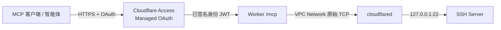

# Cloudflare SSH MCP

将私有 SSH 主机接入 MCP。使用 Cloudflare Managed OAuth 管理身份授权，以 Workers VPC 和 Tunnel 建立私网连接，为 MCP 客户端和智能体提供远程命令执行工具。

项目基于标准 SSH 协议，不绑定特定操作系统。服务端代码运行在一个 Worker 中，目标主机提供 SSH 服务并运行 `cloudflared`。

## 项目背景

Remote Desktop Commander 一类工具展示了在 AI 对话中操作远程环境的便利性。对于需要接触本地文件、终端输出和登录凭据的场景，我们希望进一步掌握连接链路与访问权限，减少对额外中心化远程执行服务的依赖。

Cloudflare SSH MCP 因此选择自行部署：Worker、Tunnel、访问策略和 SSH 密钥均由使用者在自己的账户与设备中管理，源码与配置方式公开。客户端与模型由使用者选择，服务端专注于身份校验、私网连接和 SSH 执行。

项目以轻量部署、便捷使用和尽量利用 Cloudflare 免费配额为目标。实际可用功能、额度与费用取决于相关平台规则。Cloudflare 和所选客户端及其服务商仍参与请求处理，自行部署可以减少中间服务并让使用者掌握配置。

## 架构



OAuth 解决“谁可以调用工具”，SSH 密钥解决“以哪个远程用户执行命令”。Worker 校验 Access JWT，随后通过 `SSH_VPC.connect()` 建立连接，以专用 SSH 密钥登录并校验服务器主机指纹。SSH 协议本身加密命令与输出。

## 使用场景

- **AI 对话中的远程操作**：例如在 ChatGPT 网页端调用 SSH 工具，复用已有的交互入口与模型额度。[接入说明与已验证范围](docs/scenarios/chatgpt.md)。
- **智能体的执行工具**：将同一 MCP 服务接入选定的智能体工作流，远程命令以目标 SSH 用户的权限执行。

客户端需支持本项目的 Streamable HTTP 与 Managed OAuth 接入方式，兼容性通过各客户端的真实调用验收确认。

Workers VPC 目前属于 Beta，接口可能变化。SSH 使用实验性的 [`@workeryard/undershell`](https://www.npmjs.com/package/@workeryard/undershell)，版本固定在 lockfile 中。

## 工具

```json
{"command":"whoami","timeout_seconds":15}
```

MCP 工具名称：`ssh_exec`。返回示例（用户名为示意）：

```json
{
  "stdout": "remote-user\n",
  "stderr": "",
  "exitStatus": 0,
  "truncated": false
}
```

- 默认超时 15 秒，允许 1–25 秒；命令长度最多 8192 字符。
- 每次调用创建独立 SSH 会话，工作目录和环境变量不跨调用保留。
- 使用 SSH 服务端为该用户配置的默认 shell；命令语法须与远程 shell 匹配，需要特定解释器时显式调用。
- stdout、stderr 各限制 32 KiB；截断时返回 `truncated`。
- `stderr` 非空不一定失败；根据 `exitStatus` 判断。
- 超时或断连后不会自动重放命令，远程操作可能已经开始。修改类命令必须先检查实际状态再决定是否重试。

## 交给智能体部署

让智能体从 **[SKILL.md](SKILL.md)** 开始。该入口按任务引导加载部署流程或排障资料，明确输入、资源复用、权限范围和验收标准。

- [部署流程](docs/setup.md)：输入映射、分阶段操作与成功条件。
- [排障表](docs/troubleshooting.md)：从真实错误定位下一步。
- [配置模板](wrangler.example.jsonc)：实际部署值写入被 Git 忽略的 `wrangler.local.jsonc`。

Node.js 22 与锁定依赖用于本地发布；目标端只需兼容的 SSH 服务和 Tunnel。部署流程会先核对已有资源，再完成所缺配置。

## 权限与边界

Worker 能执行该 SSH 用户权限范围内的任意命令。执行权限取决于远程账户及 SSH 服务端配置。VPC Network binding 授予经该 Tunnel 访问网络的能力，固定 SSH 地址属于本项目代码约束；有权修改 Worker 代码的人能够改变连接目的地。

MCP 入口必须由仅本人可登录的 Access 策略保护。Worker 另外校验 JWT 的签名、issuer、audience、有效期及邮箱。SSH 密钥只存于 Worker Secrets；不要提交私钥、OAuth token、Tunnel token、实际本地配置或包含这些信息的截图。

本项目仅支持短命令，不提供持久终端、后台任务管理、多机器选择或远程桌面画面。目标主机、SSH 服务和 Tunnel 必须在线。

## 源码结构

```text
SKILL.md                     智能体执行入口
src/index.ts                 MCP 工具注册、入口路由和错误返回
src/auth.ts                  Access JWT 验证
src/ssh.ts                   VPC TCP、SSH 主机校验和命令执行
wrangler.example.jsonc       无个人信息的配置模板
docs/setup.md                输入、部署阶段和成功条件
docs/troubleshooting.md      按错误选择排障路径
```

## 参考资料

- [Cloudflare VPC Networks：Tunnel binding 与原始 TCP](https://developers.cloudflare.com/workers-vpc/configuration/vpc-networks/)
- [Cloudflare Tunnel：Workers VPC 要求](https://developers.cloudflare.com/workers-vpc/configuration/tunnel/)
- [Cloudflare Access Managed OAuth](https://developers.cloudflare.com/cloudflare-one/access-controls/applications/http-apps/managed-oauth/)

参考资料用于确认平台要求；场景文档中的历史验证不能代替新环境、新客户端的实际验收。
