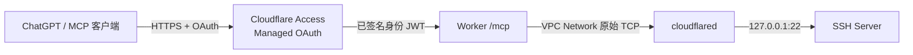

# Cloudflare SSH MCP

通过 Cloudflare Workers 将 ChatGPT 与自己的 SSH 主机连接起来。使用 Managed OAuth 管理身份授权，以 Workers VPC 和 Tunnel 建立私网连接，让 AI 在对话中调用远程命令。

项目基于标准 SSH 协议，不绑定特定操作系统。服务端代码运行在一个 Worker 中，目标主机提供 SSH 服务并运行 `cloudflared`。

## 项目背景

Remote Desktop Commander 一类工具展示了在 AI 对话中操作远程环境的便利性。对于需要接触本地文件、终端输出和登录凭据的场景，我们希望进一步掌握连接链路与访问权限，减少对额外中心化远程执行服务的依赖。

Cloudflare SSH MCP 因此选择自行部署：Worker、Tunnel、访问策略和 SSH 密钥均由使用者在自己的账户与设备中管理，源码与配置方式公开。同时，直接复用 ChatGPT 网页版已有的交互入口和模型额度，无需另行接入模型 API。

项目以轻量部署、便捷使用和尽量利用 Cloudflare 免费配额为目标。实际可用功能、额度与费用取决于相关平台规则。ChatGPT/OpenAI 与 Cloudflare 仍参与请求处理，自行部署的价值在于减少中间服务并掌握配置，而非让所有数据留在本机。

## 架构



OAuth 解决“谁可以调用工具”，SSH 密钥解决“以哪个远程用户执行命令”。Worker 校验 Access JWT，随后通过 `SSH_VPC.connect()` 建立连接，以专用 SSH 密钥登录并校验服务器主机指纹。SSH 协议本身加密命令与输出。

## 已验证的范围

2026-10-26，作为本项目来源的个人部署已完成 **ChatGPT 网页端 → Managed OAuth → Worker → VPC Network → SSH 主机 → `whoami`** 验证，实际返回远程登录用户、空 stderr 和退出码 `0`。公开源码保留相同的执行逻辑，并将个人配置替换成模板；仓库本身不附带可直接使用的远程电脑或凭据。

Workers VPC 目前属于 Beta，接口可能变化。SSH 使用实验性的 [`@workeryard/undershell`](https://www.npmjs.com/package/@workeryard/undershell)，版本固定在 lockfile 中。

## 工具

```json
{"command":"whoami","timeout_seconds":15}
```

MCP 工具名称：`ssh_exec`。返回示例（用户名为示意）：

```json
{
  "stdout": "remote-user\n",
  "stderr": "",
  "exitStatus": 0,
  "truncated": false
}
```

- 默认超时 15 秒，允许 1–25 秒；命令长度最多 8192 字符。
- 每次调用创建独立 SSH 会话，工作目录和环境变量不跨调用保留。
- 使用 SSH 服务端为该用户配置的默认 shell；命令语法须与远程 shell 匹配，需要特定解释器时显式调用。
- stdout、stderr 各限制 32 KiB；截断时返回 `truncated`。
- `stderr` 非空不一定失败；根据 `exitStatus` 判断。
- 超时或断连后不会自动重放命令，远程操作可能已经开始。修改类命令必须先检查实际状态再决定是否重试。

## 开始搭建

准备 Node.js 22、npm、Cloudflare 账户、可使用自定义 MCP/OAuth 的 ChatGPT 账户，以及一台已配置 SSH 服务和 Tunnel 的主机。

```sh
git clone https://github.com/h2562961224/cloudflare-ssh-mcp.git
cd cloudflare-ssh-mcp
npm ci --ignore-scripts
cp wrangler.example.jsonc wrangler.local.jsonc
npm run check
```

`check` 使用示例配置做 TypeScript 检查和部署打包预演，不会发布 Worker，也不会连接远程主机。填写本地配置、配置 OAuth、安装 SSH 公钥后再部署。完整操作见 **[搭建指南](docs/setup.md)**，故障定位见 **[排障指南](docs/troubleshooting.md)**。

## 配置

仅提交 `wrangler.example.jsonc`。实际部署读取被 Git 忽略的 `wrangler.local.jsonc`。

| 配置项 | 含义 |
| --- | --- |
| `name` | 自己的 Worker 名称 |
| `PUBLIC_ORIGIN` | Worker 的 HTTPS origin，无路径和末尾斜杠 |
| `ACCESS_TEAM_DOMAIN` | Zero Trust 团队域名，不含 `https://` |
| `ACCESS_AUD` | 保护 MCP 入口的 Access 应用 Audience |
| `OWNER_EMAIL` | 唯一允许调用工具的用户邮箱 |
| `SSH_USER` | SSH 登录用户 |
| `SSH_HOST_KEY` | 经可信途径核对的 SSH Ed25519 主机指纹，格式 `SHA256:...` |
| `vpc_networks[0].tunnel_id` | 目标主机所在 Tunnel 的 UUID |
| Secret `SSH_PRIVATE_KEY` | 专门为此 Worker 生成的 OpenSSH Ed25519 私钥 |

`ACCESS_AUD` 或 `OWNER_EMAIL` 未配置时拒绝所有 MCP 请求。目标固定为 Tunnel connector 所在机器的 `127.0.0.1:22`，工具参数不能指定其他主机或凭据。

## 权限与边界

Worker 能执行该 SSH 用户权限范围内的任意命令。执行权限取决于远程账户及 SSH 服务端配置。VPC Network binding 授予经该 Tunnel 访问网络的能力，固定 SSH 地址属于本项目代码约束；有权修改 Worker 代码的人能够改变连接目的地。

MCP 入口必须由仅本人可登录的 Access 策略保护。Worker 另外校验 JWT 的签名、issuer、audience、有效期及邮箱。SSH 密钥只存于 Worker Secrets；不要提交私钥、OAuth token、Tunnel token、实际本地配置或包含这些信息的截图。

本项目仅支持短命令，不提供持久终端、后台任务管理、多机器选择或远程桌面画面。目标主机、SSH 服务和 Tunnel 必须在线。

## 源码结构

```text
src/index.ts                 MCP 工具注册、入口路由和错误返回
src/auth.ts                  Access JWT 验证
src/ssh.ts                   VPC TCP、SSH 主机校验和命令执行
wrangler.example.jsonc       无个人信息的配置模板
docs/setup.md                配置和部署步骤
docs/troubleshooting.md      本次实践中的错误与定位方式
```

## 参考资料

- [Cloudflare VPC Networks：Tunnel binding 与原始 TCP](https://developers.cloudflare.com/workers-vpc/configuration/vpc-networks/)
- [Cloudflare Tunnel：Workers VPC 要求](https://developers.cloudflare.com/workers-vpc/configuration/tunnel/)
- [Cloudflare Access Managed OAuth](https://developers.cloudflare.com/cloudflare-one/access-controls/applications/http-apps/managed-oauth/)
- [OpenAI：插件身份验证](https://developers.openai.com/plugins/build/auth)

参考资料用于确认平台要求；端到端验证结果来自上文所述个人部署，不能代替新环境的实际验收。
