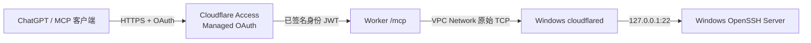

# Cloudflare SSH MCP

让 ChatGPT 网页端通过 SSH 执行自己 Windows 电脑上的命令。自定义服务代码只有一个 Cloudflare Worker；Windows 侧运行 OpenSSH Server 和 `cloudflared`，无需额外编写本机 MCP 网关或命令执行 Agent。

## 为什么做这个项目

最初想要的是类似 Remote Desktop Commander 的体验：直接在 ChatGPT 网页里，让 AI 帮自己操作电脑。但远程执行会接触命令、文件内容和终端输出，把这条链路交给中心化的远程执行服务，会让人担心隐私泄露和凭据托管问题。这是选择自行部署的动机，并非认定某个现有服务已经泄露数据。

所以做了这个尽量免费、配置完成后用起来方便的方案：把 MCP Worker 部署到自己的 Cloudflare 账户，通过自己的 Tunnel 连接电脑，用 OAuth 登录授权，再由 SSH 执行命令。源码和配置方式公开，连接目标、SSH 密钥和访问策略由自己管理。

另一个很实际的目的，就是“薅网页版额度”：复用自己 ChatGPT 网页版已有的模型额度，让网页里的 AI 调用自己的 SSH 工具，省去另外接入和支付模型 API 的步骤。本项目仍受 ChatGPT 账户本身的功能权限和使用额度限制；部署成本则以尽量落在 Cloudflare 免费配额内为目标，实际可用范围与费用以平台规则为准。

这里的隐私收益是减少一个额外的远程执行服务商。ChatGPT/OpenAI 和 Cloudflare 仍参与处理链路，命令输出也会返回 ChatGPT，因此自行部署并不意味着所有数据都留在本机。

## 架构



OAuth 解决“谁可以调用工具”，SSH 密钥解决“以哪个 Windows 用户执行命令”。Worker 校验 Access JWT，随后通过 `SSH_VPC.connect()` 建立连接，以专用 SSH 密钥登录并校验服务器主机指纹。SSH 协议本身加密命令与输出。

## 已验证的范围

2026-10-26，作为本项目来源的个人部署已完成 **ChatGPT 网页端 → Managed OAuth → Worker → VPC Network → Windows SSH → `whoami`** 验证，实际返回 Windows 用户、空 stderr 和退出码 `0`。公开源码保留相同的执行逻辑，并将个人配置替换成模板；仓库本身不附带可直接使用的远程电脑或凭据。

Workers VPC 目前属于 Beta，接口可能变化。SSH 使用实验性的 [`@workeryard/undershell`](https://www.npmjs.com/package/@workeryard/undershell)，版本固定在 lockfile 中。

## 工具

```json
{"command":"whoami","timeout_seconds":15}
```

MCP 工具名称：`ssh_exec`。返回示例（用户名为示意）：

```json
{
  "stdout": "MY-PC\\user\r\n",
  "stderr": "",
  "exitStatus": 0,
  "truncated": false
}
```

- 默认超时 15 秒，允许 1–25 秒；命令长度最多 8192 字符。
- 每次调用创建独立 SSH 会话，工作目录和环境变量不跨调用保留。
- 使用 Windows SSH 的默认 shell。需要 PowerShell 语法时显式调用 `powershell -NoProfile -Command "..."`。
- stdout、stderr 各限制 32 KiB；截断时返回 `truncated`。
- `stderr` 非空不一定失败；根据 `exitStatus` 判断。
- 超时或断连后不会自动重放命令，远程操作可能已经开始。修改类命令必须先检查实际状态再决定是否重试。

## 开始搭建

准备 Node.js 22、npm、Cloudflare 账户、可使用自定义 MCP/OAuth 的 ChatGPT 账户，以及一台已配置 OpenSSH 和 Tunnel 的 Windows 电脑。

```sh
git clone https://github.com/h2562961224/cloudflare-ssh-mcp.git
cd cloudflare-ssh-mcp
npm ci --ignore-scripts
cp wrangler.example.jsonc wrangler.local.jsonc
npm run check
```

`check` 使用示例配置做 TypeScript 检查和部署打包预演，不会发布 Worker，也不会连接 Windows。填写本地配置、配置 OAuth、安装 SSH 公钥后再部署。完整操作见 **[搭建指南](docs/setup.md)**，故障定位见 **[排障指南](docs/troubleshooting.md)**。

## 配置

仅提交 `wrangler.example.jsonc`。实际部署读取被 Git 忽略的 `wrangler.local.jsonc`。

| 配置项 | 含义 |
| --- | --- |
| `name` | 自己的 Worker 名称 |
| `PUBLIC_ORIGIN` | Worker 的 HTTPS origin，无路径和末尾斜杠 |
| `ACCESS_TEAM_DOMAIN` | Zero Trust 团队域名，不含 `https://` |
| `ACCESS_AUD` | 保护 MCP 入口的 Access 应用 Audience |
| `OWNER_EMAIL` | 唯一允许调用工具的用户邮箱 |
| `SSH_USER` | Windows SSH 登录用户 |
| `SSH_HOST_KEY` | 经可信途径核对的 SSH Ed25519 主机指纹，格式 `SHA256:...` |
| `vpc_networks[0].tunnel_id` | Windows 所在 Tunnel 的 UUID |
| Secret `SSH_PRIVATE_KEY` | 专门为此 Worker 生成的 OpenSSH Ed25519 私钥 |

`ACCESS_AUD` 或 `OWNER_EMAIL` 未配置时拒绝所有 MCP 请求。目标固定为 Tunnel connector 所在机器的 `127.0.0.1:22`，工具参数不能指定其他主机或凭据。

## 权限与边界

Worker 能执行该 SSH 用户权限范围内的任意命令。如果配置的是 Windows 管理员用户，命令具有相应管理员权限。VPC Network binding 授予经该 Tunnel 访问网络的能力，固定 SSH 地址属于本项目代码约束；有权修改 Worker 代码的人能够改变连接目的地。

MCP 入口必须由仅本人可登录的 Access 策略保护。Worker 另外校验 JWT 的签名、issuer、audience、有效期及邮箱。SSH 密钥只存于 Worker Secrets；不要提交私钥、OAuth token、Tunnel token、实际本地配置或包含这些信息的截图。

本项目仅支持短命令，不提供持久终端、后台任务管理、多机器选择或远程桌面画面。Windows 必须开机，OpenSSH 和 Tunnel 必须在线。

## 源码结构

```text
src/index.ts                 MCP 工具注册、入口路由和错误返回
src/auth.ts                  Access JWT 验证
src/ssh.ts                   VPC TCP、SSH 主机校验和命令执行
wrangler.example.jsonc       无个人信息的配置模板
docs/setup.md                配置和部署步骤
docs/troubleshooting.md      本次实践中的错误与定位方式
```

## 参考资料

- [Cloudflare VPC Networks：Tunnel binding 与原始 TCP](https://developers.cloudflare.com/workers-vpc/configuration/vpc-networks/)
- [Cloudflare Tunnel：Workers VPC 要求](https://developers.cloudflare.com/workers-vpc/configuration/tunnel/)
- [Cloudflare Access Managed OAuth](https://developers.cloudflare.com/cloudflare-one/access-controls/applications/http-apps/managed-oauth/)
- [OpenAI：插件身份验证](https://developers.openai.com/plugins/build/auth)

参考资料用于确认平台要求；端到端验证结果来自上文所述个人部署，不能代替新环境的实际验收。
